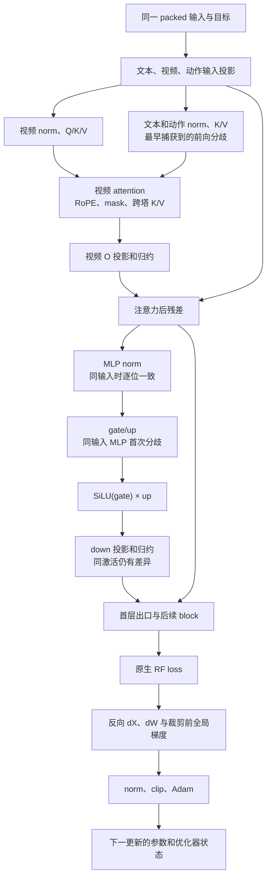

# TP/PP 正确性问题树

更新于 2026-11-26 UTC。本树追踪 Megatron TP/PP 从同一模型、训练状态和逻辑样本出发，能否复现单卡原生参考的训练语义，并在约定的数值门槛内连续更新和恢复。当前标准 FP32 的 36 层连续更新未通过。 [验收设计](v0.0.1.tp_pp.md#122-数学与更新正确性) · [问题与处理记录](v0.0.1.record.md)

## 四级验收

| 层级         | 对照对象                                                       | 独立通过标准                                                                                                                       |
| ------------ | -------------------------------------------------------------- | ---------------------------------------------------------------------------------------------------------------------------------- |
| L1 Forward   | 输入、mask、RoPE、各塔逐层输出、loss                           | 输入和元数据匹配，输出有限。每个观测边界按实验预先固定的数值门槛检查。逐位复现的对照单独报告                                       |
| L2 Backward  | 各层输入梯度、参数梯度、裁剪前完整梯度                         | 还原 canonical 参数顺序，检查梯度有无、分片、复制项和理论零项。完整 FP32 的整体相对 L2 ≤ `1e-4`，余弦 ≥ `0.999999`，并报告逐项误差 |
| L3 Optimizer | 全局 norm、裁剪系数、更新后的 FP32 master、Adam 一二阶矩、step | 使用已有非零 moments 和 step，核对学习率、冻结项和未使用梯度。权重和 moments 的相对 L2 初始上限为 `1e-4`，近零项另用预设绝对门槛   |
| L4 Training  | 至少 3 次连续更新，另做保存退出和恢复对照                      | 每步均检查 L1–L3，核对 scheduler、数据顺序、RNG 和恢复状态。BF16 loss 轨迹按计划中的独立门槛和参考重复波动验收                     |

**对照数据。** 标准 FP32 对照是单 H100 全宽原生参考与四 H100 TP4/PP1/DP1。两侧从同一份初始 FP32 master 和 Adam 状态出发，每步按同一顺序复用两份预处理微批。每份保留两条真实样本及完整文本，视频 latent、动作及目标按同一规则裁剪。TF32 和 autocast 关闭，两侧 cuBLAS workspace 均为 `:4096:8`。最近 BF16 候选的正确性对照是普通 TP4 与同拓扑候选 TP4，两边共用真实 9/11/13 样本的三个微批。FSDP4 计时属于独立性能对照。 [数据和数值记录](v0.0.1.record.md#主要问题与处理)

**判定术语。** 逐位一致用于固定输入、同一算子自复现、分片映射、要求精确的状态恢复。数值一致使用预先写明的绝对和相对门槛。训练语义要求相同的样本权重、mask、loss 分母、梯度归约和优化器规则。数学上等价的归约次序可以产生浮点差异。第三步的 **10.9%** 梯度差仍需定位和整轨迹验证。

## 树根一 · 完整 FP32 训练轨迹偏离

标准 TP4 的前三次裁剪前整体梯度相对 L2 为 **0.029%、0.144%、10.9%**。以下结论均限定在各自输入、模型范围及观测边界。 [三步和逐层证据](v0.0.1.record.md#主要问题与处理)

| 子问题或假设                                          | 状态                                                 | 对应实验                                                                                                                                                  | 结果与排除范围                                                                                                                                                                                                                                                                                         |
| ----------------------------------------------------- | ---------------------------------------------------- | --------------------------------------------------------------------------------------------------------------------------------------------------------- | ------------------------------------------------------------------------------------------------------------------------------------------------------------------------------------------------------------------------------------------------------------------------------------------------------ |
| 两臂输入或初始状态错位                                | 已排除，当前 FP32 回放                               | 固定 prepared 输入及同一 canonical master/Adam；检查实际输入指纹和四 rank 811 项初始分片                                                                  | 两臂起点与输入对齐。排除该次回放来自不同批次或不同初值的解释。生产 loader 连续性另验                                                                                                                                                                                                                   |
| 原生参考的 RoPE 常量与 GPU TP 不同                    | 已证实并修复，早期 TP2/PP2 对照                      | 将原生非持久化 RoPE 改为 CUDA 初始化并校验 SHA，再复测同输入                                                                                              | 原先四个频率的最大绝对差为 `9.31e-10`。纠正后首步梯度相对 L2 降至 `1.01723e-4`，整体及局部门槛仍未通过。排除 RoPE 初始化单独解释剩余差异。 [历史对照](../megatron_tp_pp.md#复现诊断)                                                                                                                   |
| 首步差异主要由裁剪范数或 Adam 产生                    | 首步主因已排除，完整 L3 待验证                       | 对同一份 TP 梯度对比两种范数顺序；用相同梯度和范数单独调用原生 clip 与 FusedAdam                                                                          | 同梯度的 norm 差约 `1.3e-5`，而两臂 norm 差约 `8.6e-3`。96 条裁剪样本和 60 项更新状态样本逐位一致。首步主要差异已在裁剪前，完整优化器状态仍需验收                                                                                                                                                      |
| 误差随先前更新的状态传递                              | 已证实有放大                                         | 第二、第三步分别重置为原生对应的参数和 Adam 状态，再回放同一输入                                                                                          | 整体梯度误差降至约 **0.0045%、0.0056%**，仍有逐项超限。排除“第三步误差全部在当步独立产生”的解释                                                                                                                                                                                                        |
| 首层输入、mask、RoPE、输入归一化或视频 Q/K/V 首先偏离 | 已排除，两个捕获微批                                 | 配对 dump 原生和 TP 的三流入口和首层边界，各自先复现历史结果                                                                                              | 上述边界逐位一致。首个捕获的差异在文本、动作 K/V。排除已观测入口和 mask 差异，未覆盖其它输入或反向                                                                                                                                                                                                     |
| 文本/动作 K/V 和视频输出投影改变首层残差              | 已证实，首层前向                                     | 在原分片宽度下替换 K/V；固定注意力输出后重放分片 O 加 NCCL 和原生全宽 O                                                                                   | K/V 使两个微批注意力输出误差约降 92%/89%。同输入全宽 O 参考使注意力后残差相对旧 TP 约降 83%。排除仅由注意力输入变化解释全部残差差异，O 的局部矩阵乘和归约贡献尚待区分                                                                                                                                  |
| MLP 出口差异主要沿注意力残差输入传播                  | 已排除，两个捕获微批                                 | 单独构建真实 RMSNorm/MLP，原生与 TP 先各自逐位复现，再同喂一份残差并用 FP64 分解误差                                                                      | norm 逐位一致，首次不同在 gate/up。沿出口误差方向约 99% 来自同输入 MLP 的计算差异                                                                                                                                                                                                                      |
| gate/up 的分片宽度引入舍入差异                        | 已证实，首层前向                                     | 用 dump 的 16 个算子输入逐位自复现，做局部 cuBLASLt 搜索，再只替换真实四卡 MLP 的 gate/up                                                                 | 两个投影均有 4 个局部宽度配置通过两槽、四分片、三次重复。实际替换的 16 项均与原生逐位一致，保留原 down/NCCL 后出口误差仍剩约 64%。排除 gate/up 单独解释全部误差                                                                                                                                        |
| 剩余 MLP 差异来自 down 的局部矩阵乘或归约             | 已证实到 down + NCCL 边界                            | dump 实际 `SiLU(gate) * up` 的值和布局，以同一个 gated 输入分别执行全宽 down 与分片 down + NCCL。先逐位复现原生、旧 TP 和候选各自原输出，再比较同输入结果 | 替换 gate/up 后，两个微批的 gated 输入均与原生逐位一致。同输入下 TP down + NCCL 仍分别有 `2.97e-7`、`2.94e-7` 相对 L2，解释了候选剩余的全部下投影误差                                                                                                                                                  |
| down 的前向差异主要由 NCCL 归约引起                   | 已排除为两槽的主要原因                               | 在实际 eager 下投影中捕获四卡归约前的 FP32 部分和，先确保采样前后与原输出逐位一致，再同部分和改用 FP64 NCCL；另计算 FP64 局部矩阵乘参考                   | 改归约后两个微批相对 L2 从 `2.97e-7/2.94e-7` 变为 `2.94e-7/2.92e-7`。归约在总误差方向的投影约 1.9%/2.0%，主要差异来自局部乘加与全宽原生乘加的数值路径。当前证据覆盖 eager 双微批。                                                                                                                     |
| 后层注意力反向或 Q/K norm 单点能解释完整梯度漂移      | 局部有证据，完整假设未验证                           | 固定第 32 层注意力 operands，交换 Q、K、V 和上游 dY；独立重放 Q norm 和权重梯度                                                                           | 同 CUDA 后端复现原输出和 dQ。换入全部 TP operands 后，与原 TP dQ 仅剩原差的约 0.9%/3.2%。表明该层主要随上游输入进入。待用前后向逐层报告核对其它层及首次反向分歧                                                                                                                                        |
| 固定输入后 down 的反向仍出现差异                      | 已证实输入梯度差异，已排除两槽固定输入的权重梯度差异 | 原生和真实四卡 TP 使用同一 gated 输入及同一份历史原生 `dY`。单独跑 down，再固定当前残差跑标准 MLP 的真实 autograd                                         | 单独 down 的全部 `dW` 逐位一致，`dX` 相对 L2 为 `2.46e-7`、`2.32e-7`。该 row 算子的归约反向直接传递梯度，`dX` 差异已定位到本地反向路径。标准 MLP 的 down `dW` 差异约 `8.79e-7`、`7.21e-7`，与门控激活的前向差异相符。 [归约反向](../../cosmos_framework/model/generator/megatron_tp_pp/compile.py#L49) |
| down 前向只保留完整收缩维度即可逐位对齐               | 已排除，当前双微批                                   | 同一 canonical 权重按输出行切分，每卡使用同一完整 gated 输入做矩阵乘，真实四卡 all-gather 复原输出。先逐位复现原生和原 TP                                 | 相对 L2 仅从 `2.97e-7/2.94e-7` 降至 `2.92e-7/2.90e-7`。两槽通过局部阈值，但仍有不同数值，固定 N=1024 的宽度仍可改变计算路径。运行时权重重分片与反向未测。                                                                                                                                              |
| down 反向存在保留分片的 `dX` 算子候选                 | 已证实，局部算子                                     | 从已验证反向回放取两槽同一 `dY` 和四卡权重，逐位自复现整宽和原分片 `dY @ W_shard`，再有限扫描 cuBLASLt 配置                                               | 两条自身路径对八例均逐位复现。每例执行 430 个配置，找到一个共同候选，八例各三次独立复跑均与原生逐位一致。真实反向接入和全模型轨迹待验证。                                                                                                                                                              |
| 只对齐 down dX 即可消除标准 MLP 反向差异              | 已排除，当前双微批                                   | 复用同一历史 `dY`，真实四卡 MCore 正常执行下投影的前向和反向，只替换进入上游的输入梯度。独立检查原 dX、替代 dX、前向、原 down dW 和上游梯度               | 替代 dX 逐位匹配原生，前向和原 down dW 与 TP 对照逐位一致。相对原生的 gate/up dW 下降 7.1%–9.0%，norm dW 下降 1.5%–3.7%，残差 dX 下降 3.7%–7.7%，仍有局部差异。                                                                                                                                        |
| 同时对齐 gate/up 输出和 down dX 可进一步减少上游差异  | 尚未验证                                             | 在相同残差和固定 `dY` 下做原始、仅改前向、仅改 dX、两者同时改的四臂复现。用自定义 autograd 边将同一 dY 送回实际 Linear 反向                               | 待实测。分别核对 gate/up 及门控激活、down dW、norm 和残差，确认单项和组合贡献。                                                                                                                                                                                                                        |
| 局部前向修复能恢复分片路径的 L2–L4                    | 尚未验证                                             | 依次复查同输入 VJP、同梯度 clip/Adam、统一初值的三次连续更新。对照已有全宽加原生 Q/K norm 梯度布局的实验                                                  | 全宽诊断曾三步逐位吻合，实际分片候选的反向、更新和连续轨迹仍待验证。 [全宽对照证据](../megatron_tp_pp.md#2026-11-20qk-norm-上游梯度布局与-fp32-三步诊断)                                                                                                                                               |

### 误差传播图

图标记当前有证据的前向分歧，反向应从 loss 的 dY 沿相反方向记录每个边界。实际结构和张量切分见 [三塔 block](../../cosmos_framework/model/generator/mot/small_action_tower.py#L340) 与 [TP 转换](../../cosmos_framework/model/generator/megatron_tp_pp/layers.py#L128)。

每条边界报告固定实验号、更新、微批、模态、层、节点、方向、rank 与全局分片或同逻辑行。记录 shape、stride、dtype、SHA、有限性、前/反向相对 L2、最大绝对误差和余弦。没有可比较的观测就记为未验证，零参考范数另外报告绝对误差。首次分歧按实际执行依赖和覆盖范围判定。每次变更先逐位自复现旧路径，再只换一个操作数或一个算子。

首层视频 MLP 的同输入 A/B 记录如下。两列微批均报告原 TP 与替换 gate/up 后相对原生的实测值。四个 rank 的候选输出逐位一致，表中取 rank 0。反向和余弦待采集。 [局部重放记录](v0.0.1.record.md)

| 边界         | Forward 相对 L2，微批 0 | Forward 相对 L2，微批 1 | 两微批最大绝对误差  |
| ------------ | ----------------------- | ----------------------- | ------------------- |
| down 输出    | `4.70e-7 → 2.97e-7`     | `4.65e-7 → 2.94e-7`     | `6.85e-7 → 4.77e-7` |
| 首层视频出口 | `3.00e-7 → 1.91e-7`     | `2.88e-7 → 1.84e-7`     | `6.85e-7 → 4.77e-7` |

同激活实验的原始张量及报告留存在 `outputs/megatron_tp4_fsdp4_microbatch_20261119/layer0_mlp_down_fixed_input_20261126/`。独立读取四卡原始数据复算数值后，`down-comparison.json` 的 SHA-256 为 `a62248538d2f1ae075579fb33e10fc9d9dca479a2f00b47e0a08a9098c2afe4f`。这次覆盖两微批的首层前向。算子反向和完整训练仍待验证。

归约分解的四卡原始样本及报告保存在 `outputs/megatron_tp4_fsdp4_microbatch_20261119/layer0_mlp_row_nccl_isolation_20261126/`，`row-comparison.json` SHA-256 为 `f7c170322d808d916b7e426f478537fd245c61cc64215f0bd6b8280ff32a7dc5`。FP64 汇合与高精度 CPU 汇合转回 FP32 后在两槽逐位一致。误差投影衡量各项沿总差向量的有符号贡献，百分比与直接的相对 L2 降幅分别报告。

固定梯度回放使用两份来自另一训练状态的完整 `dY`。报告和各 rank SHA 保存在 `outputs/megatron_tp4_fsdp4_microbatch_20261119/layer0_mlp_fixed_dy_vjp_20261126/`，`vjp-comparison.json` SHA-256 为 `49e85d16849c24ade36329918b29fea39267628bea959d9cabe5437815cda9ca`。同目录的 `vjp-cosine.json` 对原始梯度重新验证 SHA 并计算余弦。原始梯度保留在实验目录。此次反向覆盖标准 MLP，候选 gate/up 的反向和当前状态的真实完整梯度仍待验。

输出行分片的原始样本及报告在 `outputs/megatron_tp4_fsdp4_microbatch_20261119/layer0_mlp_down_output_shard_20261126/`，`out-comparison.json` SHA-256 为 `b53135f2dc445b3c8d47f87f56ac252b7aaf3b5b61aff4163c127ca6ac7f6320`。本轮用已验证的原生权重视图和同一完整输入，实际执行输出 all-gather。

下投影输入梯度的算子搜索使用前文同一固定 `dY`，保留分片权重和 FP32 计算。报告和复现张量在 `outputs/megatron_tp4_fsdp4_microbatch_20261119/layer0_mlp_down_dx_lt_20261126/`，最终 `status.json` SHA-256 为 `cf861766c58eb0c8e57c2ebdb91ea5c71d785dd378b7d6469377ecc4d4ef7bb9`。随后完成了实际四卡反向 hook 对照，`outputs/megatron_tp4_fsdp4_microbatch_20261119/layer0_mlp_down_dx_hook_20261126/` 中 `hook-comparison.json` 的 SHA-256 为 `e8c3c23fefbbbf112b8c2d1fd8751e57baa74e288862fb3e9807054fefaf4de4`。

## 树根二 · BF16 复制梯度与序列并行候选

| 子问题或假设                                   | 状态                                 | 对应实验                                                                                                             | 结果与排除范围                                                                                                                                                                         |
| ---------------------------------------------- | ------------------------------------ | -------------------------------------------------------------------------------------------------------------------- | -------------------------------------------------------------------------------------------------------------------------------------------------------------------------------------- |
| 普通 TP 存在跨 rank 复制梯度差异               | 已证实，原因未验证                   | 用同一 BF16 初态和三微批，按参数 SHA 比四个 rank，独立重复比较                                                       | 首步两次实验均有相同 34 项，呈 rank 0/2 与 1/3 两组，主要是视频 post-attention norm。私池两步实验的第二步为 81 项，两臂相同                                                            |
| 提前归约或私有池引入这些复制差异               | 已排除，已测配置                     | 普通 TP 与 36 层视频 up 提前归约分别记录各 rank 首步 811 项；前置 TP 私池对照跑一次 Adam 后比较下一步                | 归约候选首步同 rank 逐位，私池两步同 rank 逐位并重现首步更新后的状态。复制差异集合未改变，严格跨 rank 门槛仍未通过                                                                     |
| 轻量 VAE 私有池改变首步复制梯度或训练输入      | 已排除，当前 BF16 三微批             | 固定初始训练状态，逐槽比准备数据、RNG 和 loss，逐卡比全部 811 项裁剪前梯度                                           | 两臂同 rank 梯度和输入逐位一致，复制差异均为同样的 34 项。首步缓存清理由 2 次降到 0 次。源和输入后校验通过。 [轻量对照记录](v0.0.1.record.md#性能对比口径)                             |
| 视频复制梯度首次在第 0 层 MLP 或 norm 反向产生 | 已排除为两个微批的采样出口梯度起点   | 在普通 TP4 捕获第 0/35 层同逻辑行的输入、输出及反向梯度，先与无采样对照逐 rank 比输入、loss、状态和全部 811 个梯度   | 前向和第 35 层反向采样全一致。前两个微批的第 0 层出口梯度已分成 rank 0/2 与 1/3，输入梯度同样分组，差异出现在真实视频行。第三微批采样一致。                                            |
| BF16 复制差异在中间某个反向层边界首次可见      | 尚未验证                             | 同一次复验同时采样第 0、8、16、24、32、35 层，沿反向依赖比较三槽各 rank 的同逻辑行。仍以完整无采样梯度对照为前置门槛 | 待实测。缩小首个可见分歧的区间，再采归约前后与实际 norm、MLP 中间值。边界采样只覆盖被观测的行。                                                                                        |
| NCCL 归约方式解释 SP 候选差异                  | 已证实为部分原因                     | 在实际视频尺寸用相同 rank operands 对比 BF16 AR 后切片与 RS；再替换两类归约复测真实 36 层首步                        | 合成 64 组归约均有舍入差异。真实首步整体相对 L2 由 **81.56% 降至 41.21%**，仍有 811 项超限。排除仅靠替换归约解决全部差异                                                               |
| 五步 BF16 实际训练的 loss 达标即可验收状态     | 已排除，12 槽对照                    | 核对两臂 60 槽输入、loss、step/超参数、冻结权重及 active model/master/moments                                        | loss 和静态状态检查通过。按预设逐项门槛，6488 个 active 状态观察中有 5281 项超界。该实验没有实际梯度对照。 [五步状态证据](../megatron_tp_pp.md#2026-11-18严格恢复及三步观察的后续结论) |
| 编译中间舍入解释 SP 剩余差异                   | 已证实影响局部算子，整模型假设未完成 | 单卡同输入对比全长和分片 RMSNorm。两臂均保留 BF16 中间舍入并复测真实双 AR 首步                                       | 单卡 RMSNorm 样本逐位一致。整模型相对 L2 为 **36.02%**，普通 TP 也随编译模式变化，811 项仍超限。待用同观测边界定位剩余差异                                                             |

第 0 层前两个微批的出口梯度采样相对 L2 分别约为 `1.43e-5`、`5.65e-6`，差异分别命中真实视频行 54719、1023。四卡共 96 条样本和两类报告保存在 `outputs/megatron_tp4_fsdp4_microbatch_20261119/tp4_bf16_replica_outer_layers_20261126/`，`diagnostic_comparison.json` SHA-256 为 `28076a8357d0b0d68d08dd545bd6c0c1fdb91b19503ecbd7cb1c31371dadb270`。同目录保留相对 L2、最大绝对误差和余弦复算。

来源见 [BF16 首步和私池记录](v0.0.1.record.md#性能对比口径)。

## 树根三 · 拓扑、数据连续性与恢复

| 对照                             | L1 Forward                          | L2 Backward                                                                                    | L3 Adam 与恢复                             | L4 连续多步                                                                                                                                                                                                  |
| -------------------------------- | ----------------------------------- | ---------------------------------------------------------------------------------------------- | ------------------------------------------ | ------------------------------------------------------------------------------------------------------------------------------------------------------------------------------------------------------------ |
| 单卡原生 ↔ TP4/PP1/DP1           | 两微批局部边界已定位差异            | 36 层标准 FP32 三步超界                                                                        | 固定梯度局部通过，完整轨迹未通过           | 36 层裁剪输入第三步约 10.9%，待修复                                                                                                                                                                          |
| 单卡原生 ↔ TP2/PP2/DP1           | 小模型有验收证据，36 层仍有输出差异 | 36 层 FP32 多步曾超界                                                                          | 完整初态映射通过，小模型续训通过           | 完整原生对照未通过                                                                                                                                                                                           |
| 单卡原生 ↔ TP2/PP1/DP2           | 单层真实权重与合成 packed 样本通过  | 单层三更新对照通过                                                                             | 小模型恢复、单层状态对照通过               | 完整模型同数据轨迹待验证                                                                                                                                                                                     |
| 单卡原生 ↔ TP1/PP2/DP2（隔离项） | 36 层裁剪视频和动作，保留完整文本   | 标准路径第三步全局相对 L2 为 `9.28e-4`。对齐原生 Linear、Adam 和裁剪后，三步裁剪前梯度逐位一致 | 对齐算术后 7317 项 master/moments 完全一致 | 对齐算术的三更新通过。标准路径失败表明无 TP 矩阵切分也会有轨迹差异。 [标准路径](../megatron_tp_pp.md#真实严格重启通过与-adam-算术隔离) · [对照算术](../megatron_tp_pp.md#并行准备路径已有性能记录的阶段核算) |
| TP4/PP1/DP1 ↔ TP2/PP2/DP1        | 待同逻辑输入直比                    | 待同一全局 batch 梯度直比                                                                      | 待同一状态和 clip 设置直比                 | 待端到端直比                                                                                                                                                                                                 |

矩阵的“小模型”和“单层”结果仅适用于相应范围。跨拓扑时由同一逻辑槽位表分配样本。PP 各 stage 共用槽位顺序与 loss 元数据，DP 副本各处理自己的逻辑槽并按同一全局分母归约，TP rank 协作处理同一个微批。 [已有拓扑结果](../megatron_tp_pp.md#复现诊断) · [逻辑槽位和归约设计](v0.0.1.tp_pp.md#7-loss梯度归约与原目标保持)

| 子问题或假设                                         | 状态                               | 对应实验与结论                                                                                                                                                                           |
| ---------------------------------------------------- | ---------------------------------- | ---------------------------------------------------------------------------------------------------------------------------------------------------------------------------------------- |
| 新进程恢复遗漏 Adam 动量                             | 已证实并修复，小模型通过           | 按 DCP 分片和索引完整性构造加载状态，比较保存前后 master、moments、step，并做四卡 TP4、TP2/PP2、TP2/DP2 续跑。完整容量及 BF16 恢复仍待验收。 [恢复记录](v0.0.1.record.md#主要问题与处理) |
| 恢复时复制参数的 compute 权重与本 rank master 不一致 | 已证实并修复，受控 12 槽恢复已通过 | 31 个复制参数曾从去重后的模型值恢复，部分 rank 与本地 master 转换不一致。改用本地 FP32 master 重建 compute，对比不中断与保存退出恢复                                                     |
| 严格恢复首槽偏差仅来自 UND 预热                      | 已排除该项为唯一原因               | 从同一 checkpoint 禁用首槽 UND 预热，逐槽核对 metadata 和梯度范数                                                                                                                        |
| 真实 loader 或逻辑 RNG 在拓扑/恢复变化后漂移         | 尚未验证完整生产路径               | 固定不可变初始 checkpoint，两侧比 source IDs、raw/packed SHA、逻辑槽顺序、每槽 RNG、真实分母。分叉连续运行与保存退出再恢复，覆盖 576 槽及实际拓扑                                        |
| PP stage 边界或 DP loss 分母引入差异                 | 小规模有证据，完整模型归因待验证   | 从同一逻辑槽表分别跑 TP4、TP2/PP2、TP2/DP2，逐槽比 stage 激活、回传 dX、mask 与使用标记，再比全局分母、梯度和 Adam。仅 PP 拓扑在 stage 边界首次失配才优先检查 PP 传递                    |

## 差分实验与维护方式

- **P0 逐层报告。** 首层下投影已完成同激活隔离及固定梯度回放。前向余差已分解为局部乘加、全宽参考及归约。分片 `down dX` 已在真实反向逐位复现，随后用四臂对照验证与 gate/up 前向修复组合的影响，并对 BF16 复制梯度补充中间层边界，以缩小已观察到的反向分歧区间。先用小 capture 重放，再用完整模型确认。复用现有 [逐层分析工具](../../tools/analyze_tp_pp_layer_traces.py)、[真实模型数学入口](../../tests/megatron/tp_pp_full_source_math.py) 和 [原生数值状态对照](../../tools/compare_tp_pp_native_numerical_state.py)。统一输出 L1–L4 判定、首次有效分歧及实际覆盖范围，目前跨拓扑统一入口待实现。
- **P0 连续训练与 Adam。** 从同一初态分别做真实梯度计算、原始 clip/Adam 更新和连续三步。每步比实际 forward、梯度及更新后状态，保存真实分片和报告 SHA。原生状态逐步重置和 dump 重放作为诊断，另行保留真正连续轨迹。
- **P1 最小复现与拓扑矩阵。** 留存 Column/Row Linear、MLP、Attention、Block、PP 传递及 optimizer 的独立前反向样本。先扩展矩阵中的明确空白，再进入生产容量和真实恢复。
- **可复现记录。** 每个对照使用独立运行目录和同一个只读、不可变初始 checkpoint。记录源 commit、实际模型配置、拓扑、GPU、PyTorch/CUDA/NCCL 版本、种子与 RNG、初始模型和 optimizer SHA、每槽 batch SHA、逐步差异和运行后校验。续训分支只使用该实验自己的中间 checkpoint；固定历史状态的局部诊断须注明来源。
- **交叉核验。** 实现审查核对数学语义和参数所有权，实验设计提前写清变量、指标和可排除的原因，独立验证直接读取原始产物和清单重算关键结果。源或输入校验、资源保护、真正执行范围异常时保留失败记录，并记录尚未获得哪一级的结果。

新增结果时更新对应分支的状态、实验及排除范围，补原始报告位置和下一项最小实验。汇报视图继续维护在 [问题与处理记录](v0.0.1.record.md)。

逐层分析工具以每个微批和模态为单位，按层号正向查找前向差异，反向查找已捕获的 cotangent 差异。JSON 记录行采样的相对 L2、最大绝对误差和余弦，并单独保留完整张量的范数变化。零参考或零向量导致比值未定义时输出 `null`。这些首个观测边界用于选取后续算子回放点，完整梯度、Adam 状态和轨迹仍分别验收。 [报告实现](../../tools/analyze_tp_pp_layer_traces.py)

标准 FP32 的原生和 TP4 历史采样已自动复核。报告有 648 条前向和 432 条反向记录。以第一微批视频流为例，最早捕获到的前向差异在第 0 层出口，相对 L2 为 `3.89e-7`。从 loss 反向遍历时，第 35 层出口梯度已偏离，相对 L2 为 `5.27e-6`，须结合该层收到的上游梯度分析。报告留存在 `outputs/megatron_tp4_fsdp4_microbatch_20261119/attention_isolation_standard_fp32/layer_differential_20261126.json`，SHA-256 为 `50ab330a7fb5c635751bd4004cb59c2fae2f6128f65275520cf5cc8e6eebaf40`。
